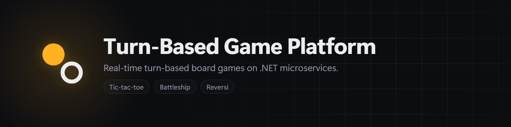

<picture>
  <source media="(prefers-color-scheme: dark)" srcset="https://github.com/turn-based-game-platform/.github/raw/main/profile/banner-dark.png">
  <source media="(prefers-color-scheme: light)" srcset="https://github.com/turn-based-game-platform/.github/raw/main/profile/banner-light.png">
  
</picture>

Online board games, turn by turn. Tic-tac-toe, battleship and reversi today, played live in the browser
with player-to-player chat; lobbies, an admin panel and player progression come next. The server owns every
rule, and each player sees the game through their own eyes, pushed to them in real time.

### The services

| Repository | What it does |
|---|---|
| [`tbgp-identity-service`](https://github.com/turn-based-game-platform/tbgp-identity-service) | Sign-in and accounts: the OpenID Connect server, player profiles, avatars and bans |
| [`tbgp-game-service`](https://github.com/turn-based-game-platform/tbgp-game-service) | Server-authoritative game sessions, one pluggable processor per game |
| [`tbgp-chat-service`](https://github.com/turn-based-game-platform/tbgp-chat-service) | Conversations and messages between players, and the invitations to a game |
| [`tbgp-notification-service`](https://github.com/turn-based-game-platform/tbgp-notification-service) | Real-time push over SignalR: every player gets their own view of each game |
| [`tbgp-user-bff`](https://github.com/turn-based-game-platform/tbgp-user-bff) | The player app's backend-for-frontend: the session, the tokens, one origin |
| [`tbgp-admin-bff`](https://github.com/turn-based-game-platform/tbgp-admin-bff) | The admin app's backend-for-frontend: admin-only routes and the systems overview |
| [`tbgp-contracts`](https://github.com/turn-based-game-platform/tbgp-contracts) | The integration events the services share, published as a NuGet package |
| [`tbgp-platform-host`](https://github.com/turn-based-game-platform/tbgp-platform-host) | The whole platform on one machine for development, and its end-to-end tests |
| [`tbgp-deploy`](https://github.com/turn-based-game-platform/tbgp-deploy) | The platform release: one Compose stack, pinned images and the bill of materials |

Every service stands on the platform's shared libraries — error contract, persistence, messaging, caching, storage,
security and a test kit, each proven once: [**platform-shared**](https://github.com/platform-shared).

### How it is built

- **.NET 10 and C# 14** — Clean Architecture, domain-driven design and CQRS; a PostgreSQL database per service.
- **Messages, not calls** — the services talk only through RabbitMQ, each event leaving through a transactional outbox.
- **Real time** — SignalR pushes each player their own view of the game; the server is the only judge of a move.
- **Backend-for-frontend** — YARP in front of the services, the session in Redis; the browser never holds a token.
- **Sign-in** — an OpenID Connect server of our own (OpenIddict).
- **Tests** — real databases and brokers in containers (Testcontainers), end-to-end scenarios over the whole stack.
- **Delivery** — every service a released image pinned by digest, one Compose stack; a server deploys a signed release
  by itself, checks every service and brings the release before back if a check fails. .NET Aspire for local development.

### Status

The backend is complete and tested, and runs on its server from signed releases; the web app comes next. The
repositories are private for now and open together with the platform.
